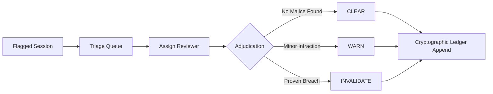

# AssessIQ Layer 5 & Invigilator Operations Admin Guide

This guide details the operation, interpretation, and governance of the **AssessIQ Layer 5 Integrity Intelligence & Invigilator Platform**.

---

## 1. Integrity Confidence Score (0–100%)

The **Integrity Confidence Score** provides an explainable, multi-factor evaluation of candidate authenticity during examination sessions.

### Score Composition & Weights
| Factor | Weight | Evaluation Criteria |
| :--- | :--- | :--- |
| **Violation Points** | **40%** | Derived from server-side `ViolationEngine`. 0 pts = 100%, 4 pts = 50%, 8+ pts = 0% (terminal cap). |
| **Gaze Stability** | **20%** | Normalized face/eye tracking variance. Normal reading drift ($\le 10\%$) is penalized at 0%; wandering gaze degrades score. |
| **Typing Authenticity** | **20%** | Measures paste volume vs original keystrokes. Pasting $>10\%$ of content introduces progressive deductions. |
| **Response Cadence** | **20%** | Flags sub-3-second submissions on complex questions (statistical speed anomalies). |

### Rating Classification
- **EXCELLENT ($\ge 85\%$)**: Full integrity confidence. No intervention needed.
- **ACCEPTABLE ($65\% - 84\%$)**: Typical variance. Minor warnings logged.
- **SUSPICIOUS ($40\% - 64\%$)**: High risk. Session automatically escalated to the Human Review Queue.
- **CRITICAL ($< 40\%$)**: Severe breaches or $\ge 8$ violation points. Instant exam termination & invigilator alert.

---

## 2. Cross-Candidate Collusion Analysis

The `CrossCandidateAnalysisEngine` runs cohort-wide post-exam and live batch scans across all candidates enrolled in the same assessment.

- **Identical Wrong Answers**: High overlap on incorrect choices is a primary mathematical indicator of shared answer keys.
- **Synchronized Timing ($\Delta t \le 3\text{s}$)**: Candidates submitting answers to the same questions within 3 seconds of each other are flagged for timing collusion.
- **Shared IP / Subnet Clustering**: Identifies candidates taking the exam from the same physical local network or proxy gateway.
- **Collusion Clusters**: Graph-based connected component clustering groups collaborating candidates into unified investigation cases.

---

## 3. Code Similarity Engine & Execution Sandbox

### Token & AST-Based Similarity
- Normalizes variable names (`var_0`, `var_1`), strips comments and whitespace formatting.
- Computes $k$-gram Jaccard similarity across code tokens.
- Pairs exceeding $70\%$ similarity are flagged for plagiarism.

### Server-Side Isolated Sandbox
- Sandboxed execution uses isolated `node:vm` contexts.
- **Network Access**: Completely blocked (no `fetch`, `WebSocket`, `http`).
- **Host Isolation**: `process`, `require`, and filesystem APIs are stripped from the sandbox environment.
- **Resource Limits**: Strict CPU execution timeout (default 2000ms) prevents infinite loops and denial-of-service attempts.

---

## 4. Essay Integrity & AI-Text Policy

### Keystroke & Revision Replay
- Tracks raw typing cadence, inter-keystroke intervals (IKI), variance, and backspace correction rates.
- Reconstructs a full **Revision History Replay** enabling proctors to scrub backwards and forwards through the candidate's exact writing process.
- Detects paste bursts exceeding 50 characters in a single event.

### Ethical AI-Text Detection Standard
> [!IMPORTANT]
> **MANDATORY POLICY**: Automated AI-text heuristics carry known false-positive rates, particularly on ESL and academic authors. All AI-text indicators are explicitly labeled with `isProof: false` and classified as **Advisory Only**. AI scores must **never** be used as autonomous grounds for exam disqualification without human review of the revision replay and typing cadence.

---

## 5. Human Review Queue Workflow

All sessions reaching **SUSPICIOUS** or **CRITICAL** status, or flagged by similarity algorithms, enter the triage queue (`/api/v1/invigilator/review-queue`).

1. **Reviewer Assignment**: Admins or senior proctors claim flagged sessions.
2. **Evidence Inspection**: Reviewers inspect the ledger event trail, code diffs, revision history replay, and snapshot logs.
3. **Formal Decision**:
   - `CLEAR`: Restores candidate score and dismisses flags.
   - `WARN`: Issues official academic advisory while maintaining score.
   - `INVALIDATE`: Voids session and cancels certification/grade.
4. **Ledger Immutability**: Every decision and reviewer note is hashed into the session's hash-chained ledger.

---

## 6. Candidate Appeals & Privacy Retention

- **Appeal Window**: Candidates have 7 calendar days from result publication to submit an appeal.
- **Transparent Rule Disclosure**: Candidates can view the specific rule triggers (e.g. `MULTIPLE_MONITORS`, `FULLSCREEN_EXIT`) without exposing sensitive proctoring heuristics or test bank secrets.
- **Privacy Auto-Purge Routine**:
  - Raw webcam frames, audio snippets, and biometric face landmarks are automatically purged once the appeal window expires or an appeal is resolved.
  - The immutable SHA-256 session ledger and Merkle root hashes are retained permanently for legal and audit compliance.

---

## 7. Invigilator Live Console (`/invigilator/dashboard`)

The live dashboard enables real-time monitoring and intervention:
- **Pause / Resume**: Temporarily freeze a candidate's timer and client screen during technical or environmental checks.
- **360° Room Re-Scan**: Trigger an immediate live 360-degree secondary scan prompt on the candidate workstation.
- **Direct & Bulk Messaging**: Send targeted instructions to individual candidates or broadcast room-wide announcements.
- **Chief Proctor Escalation**: Instantly escalate an uncooperative or actively cheating candidate to the Head of Examination.
- **Audit Commitment**: Every invigilator action is digitally signed and appended to the session ledger.

---

## 8. Daily Merkle Ledger Anchoring

To guarantee tamper evidence across historical records:
- At 00:00 UTC daily, the `DailyLedgerAnchorService` computes a cryptographic Merkle root combining the terminal hashes of all sessions active in the preceding 24 hours.
- The resulting daily root hash is stored immutably.
- Retroactive alterations to any session ledger cause an immediate hash mismatch in `verifyDailyAnchor()`.

