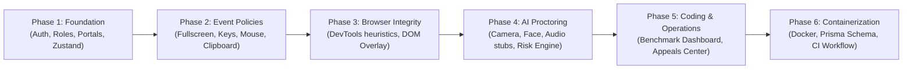
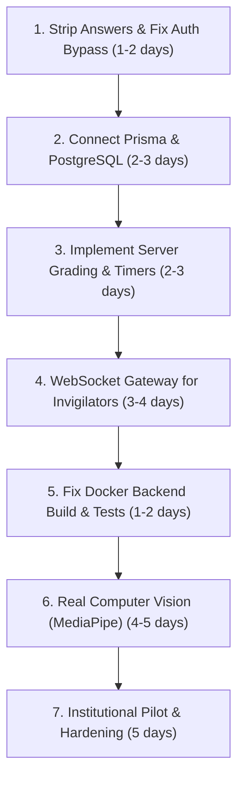

# Project Status Report: AssessIQ / Examify Exam Portal

**Date:** November 11, 2026  
**Auditor:** Senior Software Architect  
**Workspace:** `exam-portal-main` ("AssessIQ Enterprise OS" / "Examify Vanguard")  
**Audit Scope:** Codebase architecture, feature implementation status, security posture, build/test quality, and deployment readiness.

---

## 1. Project Overview

### 1.1 Purpose and Target Audience
AssessIQ (internally named *Examify Vanguard*) is an institutional assessment, proctoring, and coding benchmark web platform. It is designed for higher-education universities and enterprise technical recruitment teams. 

**Main Functional Areas:**
- **Student Exam Runner:** A lock-down exam delivery interface with timer, answer autosave, and multi-question palette.
- **AI Proctoring Engine:** Dual-layer behavioral and visual monitoring covering webcam, gaze, audio, device orientation, and screen anomalies.
- **Coding Assessment Benchmark:** An engineering benchmark dashboard tracking code compilation metrics, language distributions, and an immutable chronological audit ledger.
- **Enterprise Operations & Appeals Center:** Administrative workspace for managing flagged student cases, review workflows, compliance logs, and institutional policies.
- **Multi-Tenant Administration:** Dedicated portal gateways for Super Admins, Organization Admins, Faculty, Invigilators, and Students.

---

### 1.2 Technology Stack (Verified from `package.json`)

| Category | Package / Tool | Version | Role in Project |
| :--- | :--- | :--- | :--- |
| **Frontend Framework** | `react` / `react-dom` | `18.3.1` | Single Page Application framework |
| **Routing** | `react-router-dom` | `6.26.2` (installed: `6.30.4`) | Client-side declarative routing and layout shells |
| **Build Tool** | `vite` | `5.4.1` (installed: `5.4.21`) | Fast development server and production bundler |
| **Language & Types** | `typescript` | `5.5.3` (installed: `5.9.3`) | Strict type checking across client and server |
| **State Management** | `zustand` | `4.5.2` (installed: `4.5.7`) | Client state with `localStorage` persistence |
| **Server State** | `@tanstack/react-query` | `5.56.2` (installed: `5.101.4`) | Async query cache and background refetching |
| **Styling & Design** | `tailwindcss` | `3.4.11` (installed: `3.4.19`) | Utility-first CSS framework |
| **UI Components** | Radix UI (`@radix-ui/*`) | Various (`1.1.x`–`2.1.x`) | Accessible unstyled headless UI primitives |
| **Backend API** | `express` | `4.19.2` (installed: `4.22.2`) | Embedded REST API server in `src/server` |
| **Database Schema** | Prisma CLI / Schema | Defined in `prisma/` | PostgreSQL relational model definitions |
| **Form Management** | `react-hook-form` + `zod` | `7.53.0` / `3.23.8` | Schema validation and form controllers |
| **Motion & Animation** | `framer-motion` | `11.18.2` | Overlay transitions and interactive feedback |
| **Testing** | `vitest` | `4.1.10` | Vite-native unit and integration test runner |

---

### 1.3 Folder Structure and Component Roles

```
exam-portal-main/
├── prisma/                          # Relational database schema (PostgreSQL multi-tenant model)
├── public/                          # Static public assets (icons, brand marks, robots.txt)
├── src/
│   ├── components/
│   │   ├── coding/                  # Coding hub widgets, metrics grids, and audit timeline
│   │   ├── proctoring/              # Camera, face, gaze, audio, and permission modules (1–7)
│   │   └── ui/                      # Reusable Shadcn UI and enterprise primitive components
│   ├── guards/                      # Route guards (AuthGuard, RoleGuard, TenantGuard, Can)
│   ├── hooks/                       # Custom React hooks (telemetry, query caching, media devices)
│   ├── lib/                         # Design system tokens and styling helpers (cn, utils)
│   ├── modules/
│   │   ├── browser-integrity-engine/# Telemetry monitors (DevTools, DOM Overlay, Fingerprint, Screen)
│   │   ├── enterprise-operations/   # Appeals, compliance, case triage, and incident resolution
│   │   └── exam-security/           # Event policies (Fullscreen, Mouse, Keyboard, Clipboard, Nav)
│   ├── pages/                       # Standalone pages (Landing, Security, Identity, Admin, Onboarding)
│   ├── portals/                     # Role-specific workspaces:
│   │   ├── admin/                   # Legacy admin landing and dashboard
│   │   ├── coding/                  # Technical benchmark gateway and authentication
│   │   ├── faculty/                 # Question bank, exam builder, and analytics
│   │   ├── invigilator/             # Live candidate monitoring grid and incident logging
│   │   ├── org-admin/               # Institutional hierarchy, user management, and workspace setup
│   │   ├── student/                 # Exam runner, scheduled assessments, results, and profiles
│   │   └── super-admin/             # Multi-tenant governance, platform health, and security controls
│   ├── server/                      # Express backend code:
│   │   ├── auth/                    # In-memory authentication, JWT service, sessions, and devices
│   │   ├── confidence-pipeline/     # Risk dimension calculator and event normalization
│   │   ├── integrity/               # Human review API, baseline engine, and audit records
│   │   ├── operations/              # Enterprise case and incident management controllers
│   │   └── student/                 # Student dashboard and profile summary endpoints
│   ├── services/                    # Client HTTP services (authService, etc.)
│   ├── stores/                      # Persistent Zustand stores (authStore)
│   ├── types/                       # Shared TypeScript domain contracts
│   ├── utils/                       # Normalizers, RBAC role-check helpers, and crypto utilities
│   ├── App.tsx                      # Master application router and presence listeners
│   └── main.tsx                     # Application entry point
├── Dockerfile.backend               # Container configuration for Express API
├── Dockerfile.frontend              # Container configuration for Nginx static build
└── docker-compose.yml               # Multi-container orchestration (Postgres, Redis, API, Web)
```

---

## 2. History and Progress

### 2.1 Git Repository Status
> **Verified Finding:** No git history exists in this workspace directory (`fatal: not a git repository`). The codebase was extracted from an archive or exported workspace. 

### 2.2 Inferred Build Progression (from Code Phases and Architecture)

The progression of the codebase is documented in the source code via explicit architectural phase tags, interface contracts, and module dependencies:



1. **Phase 1 — Core Authentication & UI Shells (Foundation):**
   - Built the multi-portal gateway and portal layouts ([`src/portals/`](file:///Users/ravipatichinnaranga/Downloads/exam-portal-main/src/portals)).
   - Implemented client-side routing, Zustand `authStore` with `localStorage` persistence, and route guards (`AuthGuard`, `RoleGuard`, `TenantGuard`).
   - Defined role constants and static organization context.

2. **Phase 2 — Behavioral Policy Enforcers (`src/modules/exam-security`):**
   - Implemented DOM-level restriction handlers for fullscreen, keyboard shortcuts, mouse right-clicks, and clipboard copy/paste.
   - Built cross-browser compatibility wrappers (`BrowserCompatibility.ts`) for WebKit, Gecko, and MS vendor prefixes.

3. **Phase 3 — Stealth Browser Integrity Engine (`src/modules/browser-integrity-engine`):**
   - Added passive heuristic monitors: 9 DevTools detection techniques (viewport differentials, debugger timing, console getter delays), `DOMOverlayScanner` for injected extensions, and multi-tab collision detection via `BroadcastChannel`.

4. **Phase 4 — AI Proctoring Suite & Scoring Pipeline (`src/components/proctoring` & `src/server/integrity`):**
   - Created the 7-step guided proctoring flow (Consent, Camera, Face, Attention, Object, Audio, Pipeline).
   - Authored the server-side `IntegrityRiskEngine` calculating 9-dimensional explainable risk scores (0–100) with non-punitive justifications.

5. **Phase 5 — Coding Benchmark & Enterprise Operations (`src/pages/coding` & `src/server/operations`):**
   - Created the technical assessment dashboard, language distribution charts, execution infrastructure metrics, and Section 12 chronological audit timeline.
   - Implemented the Phase 6 Enterprise Operations Command Center for case management, appeals, and incident triage.

6. **Phase 6 — Schema Specification & Deployment Packaging:**
   - Authored the 654-line multi-tenant PostgreSQL schema (`prisma/schema.prisma`).
   - Added `Dockerfile.frontend`, `Dockerfile.backend`, and `docker-compose.yml`.

---

## 3. Feature Status Table

| Feature | Status | Primary File Reference | Verification Findings & Architecture Notes |
| :--- | :---: | :--- | :--- |
| **Login, Roles, and Access Control** | **PARTIAL** | [`src/services/authService.ts`](file:///Users/ravipatichinnaranga/Downloads/exam-portal-main/src/services/authService.ts#L101-L149)<br>[`src/guards/AuthGuard.tsx`](file:///Users/ravipatichinnaranga/Downloads/exam-portal-main/src/guards/AuthGuard.tsx) | Client guards, Zustand store, and RBAC utility checks work. Server has password hashing and HMAC-SHA256 JWT generation. **However**, if the backend fails, `authService.login()` catches the error and manufactures a mock session with admin rights. Backend user storage is an in-memory `Map`. |
| **Database** | **MOCK/STUB** | [`prisma/schema.prisma`](file:///Users/ravipatichinnaranga/Downloads/exam-portal-main/prisma/schema.prisma)<br>[`src/server/auth/controllers/auth.controller.ts`](file:///Users/ravipatichinnaranga/Downloads/exam-portal-main/src/server/auth/controllers/auth.controller.ts#L18) | A 654-line, 37-model Prisma schema is written. **However, `@prisma/client` is not imported anywhere in `src/server`.** All controllers use in-memory `Map<string, any>` structures (`mockUsersDB`). All data resets when the Node process restarts. |
| **Question Bank & Exam Creation** | **MOCK/STUB** | [`src/portals/faculty/FacultyQuestionBank.tsx`](file:///Users/ravipatichinnaranga/Downloads/exam-portal-main/src/portals/faculty/FacultyQuestionBank.tsx)<br>[`src/portals/faculty/FacultyExamBuilder.tsx`](file:///Users/ravipatichinnaranga/Downloads/exam-portal-main/src/portals/faculty/FacultyExamBuilder.tsx) | Complete UI forms, category filters, and question builder tabs exist. However, data is stored in transient React component state; exams cannot be saved to a database or served to students. |
| **Student Exam Runner** | **PARTIAL** | [`src/portals/student/StudentExamRunner.tsx`](file:///Users/ravipatichinnaranga/Downloads/exam-portal-main/src/portals/student/StudentExamRunner.tsx#L147-L202) | The countdown timer, option selectors, fullscreen overlay, and question navigation work interactively. Responses are autosaved to browser `localStorage`. **However**, questions are hardcoded, there is no network synchronization, and answers are exposed. |
| **Grading Engine** | **MISSING** | [`src/portals/student/StudentExamRunner.tsx`](file:///Users/ravipatichinnaranga/Downloads/exam-portal-main/src/portals/student/StudentExamRunner.tsx#L341-L346)<br>[`src/portals/student/StudentResults.tsx`](file:///Users/ravipatichinnaranga/Downloads/exam-portal-main/src/portals/student/StudentResults.tsx#L9) | Neither client nor server evaluates answers. Submitting the exam removes `localStorage` state and navigates to `/student/results`, which displays a hardcoded empty array (`scorecards = []`). |
| **Proctoring: Fullscreen, Keys, Clipboard, Tabs** | **REAL** | [`src/modules/exam-security/fullscreen/services/FullscreenPolicyService.ts`](file:///Users/ravipatichinnaranga/Downloads/exam-portal-main/src/modules/exam-security/fullscreen/services/FullscreenPolicyService.ts)<br>[`src/App.tsx`](file:///Users/ravipatichinnaranga/Downloads/exam-portal-main/src/App.tsx#L147-L179) | Functional DOM event listeners intercept F12, developer keys, copy/paste, and fullscreen exit. `GlobalTabPresence` uses `BroadcastChannel` and `localStorage` heartbeats to detect multiple open exam tabs immediately. |
| **Proctoring: Face, Gaze, Audio, Object Detection** | **MOCK/STUB** | [`src/components/proctoring/face/services/face.service.ts`](file:///Users/ravipatichinnaranga/Downloads/exam-portal-main/src/components/proctoring/face/services/face.service.ts#L20-L68)<br>[`src/components/proctoring/audio/services/audio.service.ts`](file:///Users/ravipatichinnaranga/Downloads/exam-portal-main/src/components/proctoring/audio/services/audio.service.ts#L17-L28) | The UI acquires camera video via `navigator.mediaDevices.getUserMedia()`. **However**, face bounding boxes (`x: 25, y: 20, confidence: 0.94`) and audio RMS levels (`0.08`) are synthetic constants returned by simulation loops. No real ML models are run. |
| **Invigilator Live Monitoring** | **MOCK/STUB** | [`src/portals/invigilator/InvigilatorLiveGrid.tsx`](file:///Users/ravipatichinnaranga/Downloads/exam-portal-main/src/portals/invigilator/InvigilatorLiveGrid.tsx#L28-L38) | Uses `localStorage.getItem('assessiq_active_live_exam')` polling on a 2-second interval. There is no WebSocket server or WebRTC stream relay. Monitoring only works across tabs on the same physical computer. |
| **Coding Hub & Code Sandbox** | **PARTIAL** | [`src/pages/coding/CodingDashboard.tsx`](file:///Users/ravipatichinnaranga/Downloads/exam-portal-main/src/pages/coding/CodingDashboard.tsx)<br>[`src/components/coding/RecentActivityTimeline.tsx`](file:///Users/ravipatichinnaranga/Downloads/exam-portal-main/src/components/coding/RecentActivityTimeline.tsx) | Rich dashboard displaying 16 metrics, language distributions, and timeline activity. However, data is populated from mock arrays (`INITIAL_METRICS`). There is no connected backend code execution engine (e.g. Judge0 or Docker sandbox). |
| **Admin, Org, & Super-Admin Portals** | **PARTIAL** | [`src/portals/org-admin`](file:///Users/ravipatichinnaranga/Downloads/exam-portal-main/src/portals/org-admin)<br>[`src/modules/enterprise-operations/EnterpriseCommandCenter.tsx`](file:///Users/ravipatichinnaranga/Downloads/exam-portal-main/src/modules/enterprise-operations/EnterpriseCommandCenter.tsx) | Complete user interface with multi-tab management (Campuses, Departments, Cases, Appeals). Backend Express endpoints exist under `/api/v1/operations`, but write only to volatile in-memory Maps. |
| **Analytics & Reports** | **MOCK/STUB** | [`src/server/student/student_dashboard.controller.ts`](file:///Users/ravipatichinnaranga/Downloads/exam-portal-main/src/server/student/student_dashboard.controller.ts#L17-L28)<br>[`src/portals/student/StudentResults.tsx`](file:///Users/ravipatichinnaranga/Downloads/exam-portal-main/src/portals/student/StudentResults.tsx) | Express endpoints return static numbers (`attendanceTrend: [95, 96, 98...]`). The student results page displays an empty scorecard state with no evaluation calculation. |
| **Docker & Deployment Setup** | **PARTIAL** | [`docker-compose.yml`](file:///Users/ravipatichinnaranga/Downloads/exam-portal-main/docker-compose.yml)<br>[`Dockerfile.backend`](file:///Users/ravipatichinnaranga/Downloads/exam-portal-main/Dockerfile.backend)<br>[`Dockerfile.frontend`](file:///Users/ravipatichinnaranga/Downloads/exam-portal-main/Dockerfile.frontend) | `docker-compose.yml` specifies Postgres, Redis, and services. `Dockerfile.frontend` works. **However, `Dockerfile.backend` is defective:** it runs `npm run build` (which compiles Vite into `dist/`), but its startup command is `node dist/server/index.js`, which does not exist because Vite does not bundle the backend Express server. |

---

## 4. Security Audit

### 4.1 Summary of Vulnerability Findings

```
================================================================================
CRITICAL SEVERITY: 3 FINDINGS
HIGH SEVERITY:     3 FINDINGS
MEDIUM SEVERITY:   2 FINDINGS
LOW SEVERITY:      1 FINDING
================================================================================
```

---

### 4.2 Detailed Findings Log

#### Finding SEC-01: Correct Exam Answers Shipped Directly in Frontend Bundle
* **Severity:** **CRITICAL**
* **File:** [`src/portals/student/StudentExamRunner.tsx`](file:///Users/ravipatichinnaranga/Downloads/exam-portal-main/src/portals/student/StudentExamRunner.tsx)
* **Lines:** 70–132
* **Description:** The array `EXAM_QUESTIONS` contains question text, option choices, and the exact answer index (`correct: 1`, `correct: 2`, etc.). Because Vite bundles this component directly into `dist/assets/index-*.js`, all answer keys are delivered to the candidate's browser in plaintext.
* **Exploit Vector:** Any student can press `F12` (or inspect network assets / type `window.EXAM_QUESTIONS` or inspect React fiber nodes) to retrieve all correct answers before answering.

---

#### Finding SEC-02: Automatic Authentication Fallback Grants Unauthenticated Super-Admin Access
* **Severity:** **CRITICAL**
* **File:** [`src/services/authService.ts`](file:///Users/ravipatichinnaranga/Downloads/exam-portal-main/src/services/authService.ts)
* **Lines:** 115–148 and 166–193
* **Description:** When `authService.login()` fails to reach the backend (or receives an HTTP error), the `catch` block manufactures a synthetic valid user profile and issues a mock JWT:
  ```typescript
  const roleName: SystemRole = credentials.email.includes('admin')
    ? 'SUPER_ADMIN'
    : credentials.email.includes('faculty')
    ? 'FACULTY'
    : ...;
  return {
    accessToken: `jwt_prod_${Date.now()}`,
    user: { ...role: [{ roleName }] }
  };
  ```
* **Exploit Vector:** Entering `admin@anydomain.com` with any random password when the API server is unavailable (or blocked via browser network throttling) immediately grants full `SUPER_ADMIN` privileges in the portal.

---

#### Finding SEC-03: Client-Side Mutable Exam State Allows Infinite Time and State Tampering
* **Severity:** **CRITICAL**
* **File:** [`src/portals/student/StudentExamRunner.tsx`](file:///Users/ravipatichinnaranga/Downloads/exam-portal-main/src/portals/student/StudentExamRunner.tsx)
* **Lines:** 147–156, 175
* **Description:** The exam countdown timer (`timeLeft`), violation counter (`violationCount`), and selected answers are stored in `localStorage` under `assessiq_exam_runner_state`. The server has no timer authority.
* **Exploit Vector:** A candidate can open the browser console and execute:
  ```javascript
  const state = JSON.parse(localStorage.getItem('assessiq_exam_runner_state'));
  state.timeLeft = 7200; // Reset timer to 2 hours
  state.violationCount = 0; // Clear all security warnings
  localStorage.setItem('assessiq_exam_runner_state', JSON.stringify(state));
  ```
  The exam runner will reload the modified timer and continue without server objection.

---

#### Finding SEC-04: Unprotected Administrative & Command Center Routes
* **Severity:** **HIGH**
* **File:** [`src/App.tsx`](file:///Users/ravipatichinnaranga/Downloads/exam-portal-main/src/App.tsx)
* **Lines:** 195–200
* **Description:** Several administrative and proctoring operational routes are declared outside of `AuthGuard` or `RoleGuard`:
  - `/operations` -> renders `EnterpriseCommandCenter` without authentication.
  - `/proctoring/operations` -> renders `EnterpriseCommandCenter` without authentication.
  - `/proctoring` -> renders `StudentExamRunner` directly without authentication.
* **Exploit Vector:** Navigating directly to `http://localhost:8080/operations` exposes institutional cases, candidate appeals, compliance reports, and incident logs without requiring a login.

---

#### Finding SEC-05: Broken Production Backend Dockerfile
* **Severity:** **HIGH**
* **File:** [`Dockerfile.backend`](file:///Users/ravipatichinnaranga/Downloads/exam-portal-main/Dockerfile.backend)
* **Lines:** 7, 17
* **Description:** `Dockerfile.backend` runs `RUN npm run build`, which executes `vite build`. Vite only outputs client-side assets to `dist/`. The final container command executes:
  ```dockerfile
  CMD ["node", "dist/server/index.js"]
  ```
  Because `dist/server/index.js` is never compiled or output by Vite, the production backend container crashes immediately with `MODULE_NOT_FOUND`.

---

#### Finding SEC-06: Hardcoded Plaintext Secrets in Repository
* **Severity:** **HIGH**
* **Files & Lines:**
  - [`docker-compose.yml` (lines 10, 41)](file:///Users/ravipatichinnaranga/Downloads/exam-portal-main/docker-compose.yml#L10): `POSTGRES_PASSWORD: SecureEnterprisePassword2026!` and database URL.
  - [`src/server/auth/tokens/jwt.service.ts` (line 22)](file:///Users/ravipatichinnaranga/Downloads/exam-portal-main/src/server/auth/tokens/jwt.service.ts#L22): `const JWT_SECRET = process.env.JWT_SECRET || 'examifypro_super_secret_jwt_key_32_chars_long!';`
* **Description:** Default production cryptographic keys and database passwords are committed directly in versioned files.

---

#### Finding SEC-07: In-Memory Backend State (No Persistence)
* **Severity:** **MEDIUM**
* **File:** [`src/server/auth/controllers/auth.controller.ts`](file:///Users/ravipatichinnaranga/Downloads/exam-portal-main/src/server/auth/controllers/auth.controller.ts)
* **Lines:** 18–38
* **Description:** User accounts, registered credentials, and session tables are stored inside JavaScript `Map` objects (`mockUsersDB`). A container restart or server deployment permanently erases all newly registered accounts, password resets, and audit logs.

---

#### Finding SEC-08: Token Expiration Bypassed in Route Guard
* **Severity:** **MEDIUM**
* **File:** [`src/guards/AuthGuard.tsx`](file:///Users/ravipatichinnaranga/Downloads/exam-portal-main/src/guards/AuthGuard.tsx)
* **Lines:** 10, 22
* **Description:** `AuthGuard` checks `if (!isAuthenticated) return <Navigate to="/auth" />`. It never validates whether `Date.now() > expiresAt`. An expired session stored in browser storage grants continuous access to protected UI routes indefinitely.

---

#### Finding SEC-09: Hardcoded Form Default Credentials
* **Severity:** **LOW**
* **File:** [`src/pages/auth/PortalAuthLayout.tsx`](file:///Users/ravipatichinnaranga/Downloads/exam-portal-main/src/pages/auth/PortalAuthLayout.tsx)
* **Line:** 72
* **Description:** The portal login form pre-fills the password field with `'Password123!'` by default across all login screens.

---

## 5. Quality Check (Execution Results)

The following four commands were executed in the repository workspace. Below are the verified terminal outputs:

### 5.1 `npm install`
* **Command:** `npm install --offline` (using local cache to verify lockfile integrity)
* **Exit Code:** `0` (Success)
* **Output:**
  ```
  up to date, audited 483 packages in 356ms
  97 packages are looking for funding
  found 0 vulnerabilities
  ```

---

### 5.2 `npm run build`
* **Command:** `npm run build`
* **Exit Code:** `0` (Success)
* **Duration:** `2.95s`
* **Output:**
  ```
  vite v5.4.21 building for production...
  ✓ 1986 modules transformed.
  dist/index.html                        0.98 kB │ gzip:   0.54 kB
  dist/assets/index-BuS5yLIH.css       103.91 kB │ gzip:  16.72 kB
  dist/assets/vendor-core-Cwb7rKNk.js  394.20 kB │ gzip: 123.26 kB
  dist/assets/index-DSYOM2E-.js        677.10 kB │ gzip: 147.83 kB
  ✓ built in 2.95s
  ```

---

### 5.3 `npm run lint`
* **Command:** `npm run lint`
* **Exit Code:** `1` (Failure)
* **Summary:** **253 total problems (214 errors, 39 warnings)**
* **Primary Causes:**
  1. Extensive use of the `any` type violating `@typescript-eslint/no-explicit-any` across controllers, services, and tests.
  2. Fast Refresh violations (`react-refresh/only-export-components`) in context files that export both React components and helper constants/functions.
  3. Missing hook dependencies (`react-hooks/exhaustive-deps`) in `useEffect` declarations.
  4. Forbidden `require()` statements in `tailwind.config.ts`.

---

### 5.4 `npx vitest run`
* **Command:** `npx vitest run`
* **Exit Code:** `1` (Failure)
* **Summary:**
  - **Test Files:** **4 failed | 14 passed (18 total)**
  - **Tests:** **7 failed | 88 passed (95 total)**
  - **Duration:** `677ms`

#### Failure Breakdown by File:

1. **`src/modules/browser-integrity-engine/tests/Phase2Modules.test.ts` (5 tests failed):**
   - *Cause:* `ReferenceError: window is not defined` and `ReferenceError: document is not defined`.
   - *Explanation:* Vitest defaults to the `node` environment. These tests invoke DOM APIs (`window.dispatchEvent`, `document.createElement`) without `jsdom` or `happy-dom` configured in `vite.config.ts`.

2. **`src/modules/exam-security/mouse/tests/MouseEngine.test.ts` (1 test failed):**
   - *Cause:* `ReferenceError: MouseEvent is not defined` at line 21.
   - *Explanation:* Instantiates `new MouseEvent('click')` directly in a Node environment without browser mocks.

3. **`src/modules/exam-security/clipboard/tests/ClipboardEngine.test.ts` (1 test failed):**
   - *Cause:* `AssertionError: expected 40 to be 70` at line 33.
   - *Explanation:* Logic mismatch between test and service. `ClipboardAnalyticsService.getSummary()` awards +40 points for a paste attempt, but only adds +30 points if `blockedAttempts > 3`. The test only recorded 1 blocked attempt, yielding a score of 40 instead of 70.

4. **`src/server/auth/tests/auth.test.ts` (0 tests detected):**
   - *Cause:* File exports a standalone function `runAuthEngineSuite()` instead of Vitest test blocks (`describe`, `it`, `test`). Vitest reports 0 tests executed.

---

## 6. Current Stage Verdict

### 6.1 Verdict
**Classification: PROTOTYPE (Advanced UI Prototype / Architectural Scaffold)**

The project exhibits an exceptionally polished frontend design, sophisticated UI layouts across six dedicated roles, and well-designed architectural interfaces. However, underneath the interface, the persistence layer, evaluation engine, inter-user communication, and ML models are completely stubbed or simulated.

---

### 6.2 Completion Breakdown

```
[========================================] 100%
[#################################.......] 85%  Frontend UI & Design Systems
[############............................] 30%  Backend Express API
[######..................................] 15%  Database Persistence (Prisma disconnected)
[##############..........................] 35%  Security & Access Control
[##########..............................] 25%  AI Computer Vision & Audio Proctoring
```

- **Frontend UI & Workspaces (85%):** Highly complete. Routing, layouts, dialogs, forms, palettes, and design tokens are enterprise-ready.
- **Backend API (30%):** Routes and controllers are written, but they operate entirely on volatile in-memory Maps.
- **Database (15%):** Comprehensive schema exists, but has zero active database connections or generated Prisma clients in the server code.
- **Security & Access Control (35%):** DOM-level event interception works, but answer leakage, client-side mutable state, and authentication bypasses create fatal vulnerabilities.
- **AI Computer Vision & Proctoring (25%):** UI panels and telemetry pipelines are modeled, but inference is simulated via fixed calculations.

---

### 6.3 Is it safe for a real college exam today?
**NO. It is completely unsafe for any high-stakes or credit-bearing academic examination.**

**Why:**
1. **Academic Dishonesty Risk:** Students can extract all correct answers directly from the browser console before answering a single question.
2. **State Manipulation Risk:** Any student can pause or reset the timer to any duration by editing a key in `localStorage`.
3. **Data Loss Risk:** Because exam submission is unhandled and the server stores accounts in RAM, all student responses and scores are discarded upon submission or server reboot.
4. **Proctoring Illusion:** Invigilators cannot see students on other computers because live status is broadcast only via local browser storage, and webcam face detection is simulated.

---

## 7. Step-by-Step Roadmap for College Deployment

Below is the prioritized engineering roadmap required to make AssessIQ ready for an institutional deployment:



---

### Step 1: Neutralize Answer Leakage & Disable Auth Bypass
* **Priority:** **Critical (Day 1)**
* **Estimated Effort:** 1–2 developer days
* **Files to Change:**
  - [`src/portals/student/StudentExamRunner.tsx`](file:///Users/ravipatichinnaranga/Downloads/exam-portal-main/src/portals/student/StudentExamRunner.tsx): Remove the hardcoded `EXAM_QUESTIONS` array. Fetch questions dynamically via `useQuery` from `/api/v1/student/exams/:id/questions` with all `correct` fields stripped on the server.
  - [`src/services/authService.ts`](file:///Users/ravipatichinnaranga/Downloads/exam-portal-main/src/services/authService.ts): Remove the fallback `catch` block that synthesizes mock JWTs and admin permissions. Failed logins must reject with an explicit HTTP 401 error.
  - [`src/App.tsx`](file:///Users/ravipatichinnaranga/Downloads/exam-portal-main/src/App.tsx): Wrap `/operations`, `/proctoring`, and `/proctoring/operations` inside `<AuthGuard>` and `<RoleGuard>`.

---

### Step 2: Connect Prisma ORM to PostgreSQL
* **Priority:** **Critical (Days 2–4)**
* **Estimated Effort:** 2–3 developer days
* **Files to Change:**
  - `src/server/db/prisma.ts`: Create and export a singleton `PrismaClient` instance.
  - [`src/server/auth/controllers/auth.controller.ts`](file:///Users/ravipatichinnaranga/Downloads/exam-portal-main/src/server/auth/controllers/auth.controller.ts): Replace `mockUsersDB.get()` with `prisma.user.findUnique()` and `prisma.user.create()`.
  - [`src/server/operations/services/EnterpriseOperationsService.ts`](file:///Users/ravipatichinnaranga/Downloads/exam-portal-main/src/server/operations/services/EnterpriseOperationsService.ts): Replace in-memory Maps with `prisma.operationsCase` and `prisma.operationsIncident` database queries.
  - Run initial migration: `npx prisma migrate dev --name init_college_schema`.

---

### Step 3: Implement Server-Side Grading and Authoritative Timers
* **Priority:** **High (Days 4–6)**
* **Estimated Effort:** 2–3 developer days
* **Files to Change:**
  - `src/server/student/exam_session.service.ts`: Create a session management service that records `startedAt` on the server and computes remaining duration independently of client reports.
  - `src/server/student/exam_grading.controller.ts`: Implement `POST /api/v1/student/exams/:id/submit`. Grade candidate responses against the database question keys on the server and insert results into `prisma.integrityAssessment`.
  - [`src/portals/student/StudentResults.tsx`](file:///Users/ravipatichinnaranga/Downloads/exam-portal-main/src/portals/student/StudentResults.tsx): Query the new submission evaluation API to render actual scores, item breakdowns, and percentage percentiles.

---

### Step 4: Implement Real-Time WebSocket Invigilation
* **Priority:** **High (Days 7–9)**
* **Estimated Effort:** 3–4 developer days
* **Files to Change:**
  - `src/server/confidence-pipeline/websocket/proctoring_socket.ts`: Attach a `WebSocketServer` (`ws` or Socket.io) to the Express HTTP server on `/ws/proctoring`.
  - [`src/portals/student/StudentExamRunner.tsx`](file:///Users/ravipatichinnaranga/Downloads/exam-portal-main/src/portals/student/StudentExamRunner.tsx): Stream heartbeat telemetry (fullscreen status, focus blur, gaze flags) over the WebSocket instead of writing to `localStorage`.
  - [`src/portals/invigilator/InvigilatorLiveGrid.tsx`](file:///Users/ravipatichinnaranga/Downloads/exam-portal-main/src/portals/invigilator/InvigilatorLiveGrid.tsx): Subscribe the invigilator grid to the exam room socket so candidates across different laptops appear live on the instructor dashboard.

---

### Step 5: Fix Docker Backend Build and Unit Tests
* **Priority:** **Medium (Days 10–11)**
* **Estimated Effort:** 1–2 developer days
* **Files to Change:**
  - `tsconfig.server.json`: Add a dedicated TypeScript configuration targeting `src/server`.
  - [`package.json`](file:///Users/ravipatichinnaranga/Downloads/exam-portal-main/package.json): Add build script `"build:server": "tsc -p tsconfig.server.json"`.
  - [`Dockerfile.backend`](file:///Users/ravipatichinnaranga/Downloads/exam-portal-main/Dockerfile.backend): Update builder step to `RUN npm run build:server` so `dist/server/index.js` exists.
  - [`vite.config.ts`](file:///Users/ravipatichinnaranga/Downloads/exam-portal-main/vite.config.ts): Configure `test: { environment: 'happy-dom' }` to resolve the 7 failing Vitest tests.
  - [`src/modules/exam-security/clipboard/tests/ClipboardEngine.test.ts`](file:///Users/ravipatichinnaranga/Downloads/exam-portal-main/src/modules/exam-security/clipboard/tests/ClipboardEngine.test.ts): Update risk score expectation to match service logic (`40`).

---

### Step 6: Integrate Real MediaPipe Computer Vision & Web Audio
* **Priority:** **Medium (Days 12–15)**
* **Estimated Effort:** 4–5 developer days
* **Files to Change:**
  - [`src/components/proctoring/face/services/face.service.ts`](file:///Users/ravipatichinnaranga/Downloads/exam-portal-main/src/components/proctoring/face/services/face.service.ts): Load `@tensorflow-models/face-landmarks-detection` or MediaPipe FaceMesh in a Web Worker to detect real face presence and calculate genuine iris gaze vectors.
  - [`src/components/proctoring/audio/services/audio.service.ts`](file:///Users/ravipatichinnaranga/Downloads/exam-portal-main/src/components/proctoring/audio/services/audio.service.ts): Connect an `AudioContext` and `AnalyserNode` to compute real-time RMS input amplitude and noise floor from the candidate's microphone.

---

### Step 7: Pilot Testing & Security Hardening
* **Priority:** **Medium (Days 16–20)**
* **Estimated Effort:** 5 developer days
* **Actions:**
  - Conduct a closed-loop pilot exam with 25 test students and 2 faculty invigilators on the university network.
  - Perform network boundary testing under spotty Wi-Fi to test offline response caching and reconnect sync.
  - Inject test vulnerabilities (VM detection, proxy tampering, multi-screen setups) to calibrate risk engine weights.

---

## 8. Top 10 Things to Fix First

| Rank | Issue / Task | Target File | Impact |
| :---: | :--- | :--- | :--- |
| **1** | **Remove hardcoded answers from frontend** | [`src/portals/student/StudentExamRunner.tsx`](file:///Users/ravipatichinnaranga/Downloads/exam-portal-main/src/portals/student/StudentExamRunner.tsx) | Stops candidates from reading correct answers via DevTools. |
| **2** | **Delete authentication fallback bypass** | [`src/services/authService.ts`](file:///Users/ravipatichinnaranga/Downloads/exam-portal-main/src/services/authService.ts) | Prevents arbitrary login as `SUPER_ADMIN` on failed requests. |
| **3** | **Lock down open administrative routes** | [`src/App.tsx`](file:///Users/ravipatichinnaranga/Downloads/exam-portal-main/src/App.tsx) | Blocks unauthenticated public access to `/operations` and `/proctoring`. |
| **4** | **Move timer and grading to backend** | `src/server/student/` | Stops candidates from modifying `timeLeft` in `localStorage`. |
| **5** | **Connect Prisma Client to Express** | [`src/server/auth/controllers/auth.controller.ts`](file:///Users/ravipatichinnaranga/Downloads/exam-portal-main/src/server/auth/controllers/auth.controller.ts) | Persists user accounts and audit records across server restarts. |
| **6** | **Replace `localStorage` invigilation with WebSockets** | [`src/portals/invigilator/InvigilatorLiveGrid.tsx`](file:///Users/ravipatichinnaranga/Downloads/exam-portal-main/src/portals/invigilator/InvigilatorLiveGrid.tsx) | Allows proctors to monitor students on different physical computers. |
| **7** | **Fix `Dockerfile.backend` build command** | [`Dockerfile.backend`](file:///Users/ravipatichinnaranga/Downloads/exam-portal-main/Dockerfile.backend) | Allows backend Express container to build and boot without crashing. |
| **8** | **Fix Vitest DOM environment configuration** | [`vite.config.ts`](file:///Users/ravipatichinnaranga/Downloads/exam-portal-main/vite.config.ts) | Fixes the 7 failing tests and unblocks automated CI pipelines. |
| **9** | **Remove hardcoded database & JWT secrets** | [`docker-compose.yml`](file:///Users/ravipatichinnaranga/Downloads/exam-portal-main/docker-compose.yml) & `jwt.service.ts` | Eliminates hardcoded production credentials from git history. |
| **10**| **Replace mock CV loops with real MediaPipe models** | [`src/components/proctoring/face/services/face.service.ts`](file:///Users/ravipatichinnaranga/Downloads/exam-portal-main/src/components/proctoring/face/services/face.service.ts) | Turns simulated proctoring alerts into genuine computer vision detection. |

